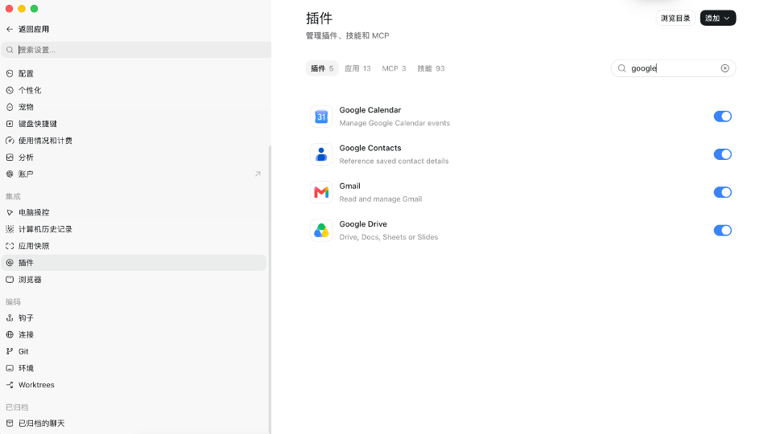

# Agent 安装指引

当用户要求安装本仓库 skill 时执行此流程。用户仅要求阅读或介绍仓库时，不执行安装。

## 1. 获取并检查

仓库：https://github.com/AllenArtefacter/agentic-artefact-skills

技能目录：`skills/agentic-artefact-project-collaboration/`，入口：`SKILL.md`。

先读取技能入口与相关安装材料，确认与用户请求一致。安装整个技能目录，保留 scripts、references、assets 等相对路径，不能只复制 SKILL.md。仓库 README、测试、dist 不需要放进技能目录。

优先使用当前宿主提供的 GitHub skill 安装器，传入上述仓库及技能目录。Codex 可使用自带 skill-installer 的 install-skill-from-github.py：

```sh
python3 <skill-installer目录>/scripts/install-skill-from-github.py --repo AllenArtefacter/agentic-artefact-skills --path skills/agentic-artefact-project-collaboration
```

这里的路径占位符必须根据宿主实际安装位置解析，不可原样运行。

没有安装器时，把仓库 clone 到新建的临时目录，检查后仅复制完整技能目录到宿主的个人 skills 目录。使用宿主当前文档或已存在配置确定目录，不凭空猜测。Codex 使用 `$CODEX_HOME/skills`，未设置时为 `~/.codex/skills`。其他宿主使用其自己的个人技能目录。不要把本仓库指令追加到用户的全局系统提示文件。

目标目录存在时先比较：相同则报告已安装；不同则保留现有内容并说明更新差异，按用户的更新授权执行，不能直接覆盖个人修改。不要为安装本 skill 修改其他 skills。

## 2. 引导 Google 集成接入

执行 [Google 接入流程](skills/agentic-artefact-project-collaboration/references/dependencies.md)。优先复用当前宿主的 Google Drive/Workspace MCP 或连接器；缺失时由 agent 查找正确集成并提供安装/连接入口。能由 agent 执行的配置在确认后执行；用户完成宿主要求的安装点击和 Google 浏览器授权。

不默认安装 gws/gog，不索取团队客户端 JSON，不要求用户配置 GCP。旧 CLI/OAuth 路线已移出当前包。不要把“安装了插件”当作“已授权”，也不要把“已授权”当作“能访问项目”。

### Codex 用户的认证入口

若 Google Drive 尚未连接，agent 应明确告诉用户：**Codex → 设置 → 插件 → 搜索 `google` → 点开 Google Drive → 在认证页面完成授权**。用户完成后，agent 验证指定项目的只读访问；已连接则跳过重复认证。

[完整图文指引](skills/agentic-artefact-project-collaboration/references/codex-google-drive-setup.md)



Google Drive 已启用但链接了其他账号时，不必重装：**设置 → 插件 → Google Drive → 下拉菜单 → 已链接用户 → 添加**，用该同事自己的、能访问项目的账号授权，再重新验证项目链接。未找到文件夹不能直接断定账号错误；也需考虑链接和文件权限。

### Claude 用户的认证入口

Google Drive 尚未连接时，引导用户：**Settings → Connectors → Google Drive → Connect → 完成 Google 授权**。若 Yours 中没有 Google Drive，可在 Discover 或搜索中查找。截图中已有状态勾选，应先验证项目访问，不重复认证。Claude Code 需另行核验当前会话实际可用工具。

[完整图文指引](skills/agentic-artefact-project-collaboration/references/claude-google-drive-setup.md)


**回复要求：** 需要用户连接时，直接发送对应客户端的截图和点击步骤，不要仅输出图片路径。优先使用宿主可展示的图片；无法内嵌时给出上面指引中的 GitHub 图片链接，并明确显示限制。不要等待用户再索要图文指引。

## 3. 验证与说明

确认目标目录中的 SKILL.md 可读，脚本及引用资源齐全；报告安装位置与源 commit。按照当前宿主的加载机制说明何时生效；若本轮无法加载新技能，明确告诉用户下一轮或重新打开会话后使用。

安装本身无需 Google 凭据，不会启动监听器，也不会自动加入项目。不为验证安装而修改真实项目。不要求用户把 token 发到聊天或提交仓库。

安装成功后，必须按 [功能欢迎指引](skills/agentic-artefact-project-collaboration/references/welcome.md) 主动介绍主要用途，并给出“总结会议纪要”“我的任务”“项目情况”等可直接发送的示例。不要只报告安装路径和 commit。

## 4. 加入已有项目

用户提供 Artefact 项目文件夹链接、姓名、邮箱和职责后，使用 work 模式。先验证当前连接能读取指定项目，再读取 Project、STATUS 和任务入口。只读测试不修改项目、不访问父目录。个人绑定或共享资料更改遵守先询问的全局限制。

连接问题联系 [Allen](mailto:allen.liang@artefact.com)，不自动发邮件。不要求普通成员处理 GCP IAM；公司管理员限制不能通过换 CLI 绕过。

## 从旧名称迁移

旧版本技能名为 `project-collaboration`。安装新版前检查宿主个人技能目录是否仍有旧版本；说明新旧名称并询问用户是否迁移。确认后将旧目录备份到技能扫描目录之外，再安装新版，避免旧的通用描述继续触发。未获确认则不删除或更改旧安装，明确提示旧版仍可能被加载。不要保留同时启用的同内容别名。
