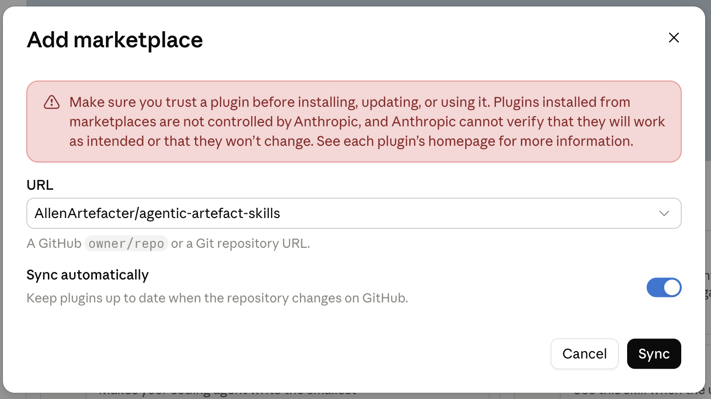

# Plugin installation and updates

Use one installation method per host: marketplace plugin or standalone skill. This package provides collaboration instructions and templates; it does not install a Google MCP server, grant Drive access or share anyone's login.

## Codex

**Recommended: use the Codex desktop UI.**

1. **Settings → Plugins → Add → Add marketplace**（设置 → 插件 → 添加 → 添加市场）.
2. Source: `https://github.com/AllenArtefacter/agentic-artefact-skills`.
3. Keep Git ref at its default (`main`); leave Sparse paths empty. Do not enter the example `plugins/codex`.
4. Click Add marketplace, open Agentic Artefact Skills and install/enable Agentic Artefact Project Collaboration. Adding the marketplace alone does not install the plugin.
5. Start a new conversation if needed, then connect Google with your own authorized account.


Agents should show these steps and the screenshot directly. [Bundled onboarding guide](../skills/agentic-artefact-project-collaboration/references/codex-marketplace-install.md).

For updates, use Plugins → Marketplaces → Agentic Artefact Skills → Upgrade, then verify the installed plugin version and update it if the client offers a separate control.

### CLI alternative

Run these in a terminal with a Codex CLI that supports `codex plugin` (or ask your agent to execute them):

```sh
codex plugin marketplace add AllenArtefacter/agentic-artefact-skills
codex plugin add agentic-artefact-project-collaboration@agentic-artefact-skills
```

Start a new conversation after installation. If the CLI has no plugin command, update the client or use the standalone skill instructions in INSTALL.md.

To fetch a new release and install it:

```sh
codex plugin marketplace upgrade agentic-artefact-skills
codex plugin add agentic-artefact-project-collaboration@agentic-artefact-skills
```

Start a new conversation to load the update. Marketplace refresh and plugin installation are separate steps. Do not assume Claude's “Check for updates” wording or automatic-update behavior applies to every Codex version.

## Claude web / desktop (recommended UI)

1. **Customize → Plugins → Add → Add marketplace**.
2. URL: `AllenArtefacter/agentic-artefact-skills` (the full GitHub URL also works).
3. Keep **Sync automatically** enabled for ongoing updates, or choose manual updates if preferred, then click **Sync**.
4. After synchronization/security scanning, open **Agentic Artefact Project Collaboration** and click **Add**. Adding the marketplace is not the same as installing its plugin.
5. Connect Google separately with your own authorized account and verify project access.




For manual updates, use **Add → Manage marketplaces** and the marketplace's available sync/check-for-updates action. Verify the synchronized version. Agents should show both screenshots and these steps directly; see the [bundled guide](../skills/agentic-artefact-project-collaboration/references/claude-marketplace-install.md).

## Claude Code CLI alternative

Run these in a terminal:

```sh
claude plugin marketplace add AllenArtefacter/agentic-artefact-skills
claude plugin install agentic-artefact-project-collaboration@agentic-artefact-skills
```

For automatic updates, open `/plugin` → Marketplaces → agentic-artefact-skills → Enable auto-update. Third-party marketplaces do not enable automatic updates by default. To update manually:

```sh
claude plugin marketplace update agentic-artefact-skills
claude plugin update agentic-artefact-project-collaboration@agentic-artefact-skills
```

Reload plugins if your version supports it, or start a new session. Other Claude surfaces may expose GitHub marketplace installation in their UI; follow that client's available controls rather than treating terminal commands as UI steps.

[Claude marketplace documentation](https://code.claude.com/docs/en/plugin-marketplaces) · [Claude installation and updates](https://code.claude.com/docs/en/discover-plugins)

## Existing standalone installation

Check for an existing `agentic-artefact-project-collaboration` skill before installing the plugin. Explain the migration and obtain approval before moving the standalone folder outside the host's skill discovery directory. Preserve personal modifications. Do not leave both copies active or delete other skills. Plugin updates do not update old standalone copies.

## After installation

Follow INSTALL.md sections 2–4. Show the onboarding screenshot and steps when a Google connection is missing; use the user's own account. Verify read access only to the project folder the user supplies. Introduce meeting summaries, personal tasks, project status, output registration and project initialization.

## Maintainers

Root `skills/` remains the editable source for Claude and standalone installations. Codex reads the self-contained distribution at `plugins/agentic-artefact-project-collaboration/`, listed by `.agents/plugins/marketplace.json`. Do not edit its copied skills directly or reference files outside the installed plugin.

After editing root skills, run:

```sh
python3 scripts/build_codex_plugin.py
python3 scripts/build_codex_plugin.py --check
python3 -m unittest discover -s tests -p 'test_project_collaboration.py'
```

Commit generated package changes with the source changes. Run the check command before every push to catch stale copies. When publishing a new content release, increment both plugin manifests' versions together; refresh README and CHANGELOG as appropriate. No credentials, personal project bindings or customer materials belong in either package.

## Brand asset (0.16.0)

The approved logo ships in `skills/agentic-artefact-project-collaboration/assets/branding/agentic-artefact.png`. Codex plugin and standalone skill metadata reference it. Both plugin manifests use version 0.16.10. Update the plugin through its marketplace; copied standalone skills need a separate skill update.

Claude receives the image as a bundled asset, but Claude Code does not read the directory-listing `icon` field, so downloading the asset does not guarantee a custom icon in its UI. See the [official manifest reference](https://code.claude.com/docs/en/plugins-reference).

Version 0.16.3 removes the Claude manifest `icon` field: the tested Claude marketplace sync reports it as unrecognized and strips it. The bundled image and Codex icon metadata remain. Do not promise a custom Claude plugin avatar via this field; directory documentation does not establish support in this sync path.

Version 0.16.4 intentionally retries the exact `"icon": "./logo.png"` configuration, with the approved image at the Claude plugin root. This is an explicit compatibility experiment: the prior sync rejected the icon key itself, so it may still warn or omit the avatar. Codex icon configuration is unchanged.

Version 0.16.6 removes the Claude manifest `icon` field again: the claude.ai marketplace sync reported `unrecognized key in plugin.json: 'icon' (stripped)` as a warning with 0.16.4/0.16.5. Claude displays the plugin via `displayName`; `logo.png` stays in the repo only as a source asset.
