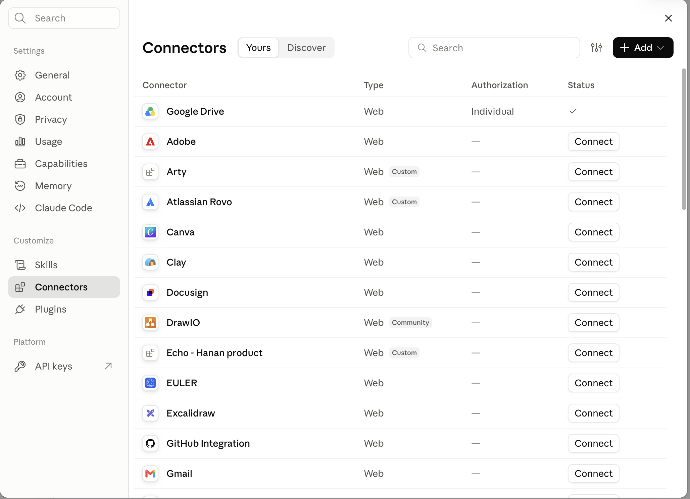

# Claude: connect Google Drive

Use this guide for Claude users whose Google Drive connection is unavailable. Check the current session first; reuse a working connection.

Tell the user:

> 在 Claude 中打开 Settings → Connectors → 找到 Google Drive → 点击 Connect（或打开详情后的连接入口）→ 选择能访问团队项目的 Google 账号并完成授权。完成后告诉我，我会验证项目访问并继续。

English equivalent:

> In Claude, open Settings → Connectors → find Google Drive → select Connect (or open its connection details) → complete Google sign-in and authorization. Use the account that can access the team project. Tell me when finished; I will verify access and continue.

The maintainer supplied this screenshot on 19 Oct 2026. It shows Google Drive under Yours, with Type Web, Authorization Individual and a status check mark. This is an already-connected example, not the authorization page. When the user sees this state, check actual project access rather than asking for another login. A status icon alone does not prove access to a specific project or support for editing.

If Google Drive is not listed under Yours, use the visible Discover tab or search to find it, then follow the actual connection entry. Do not invent an MCP URL or require Custom connector / client JSON for this normal hosted connection. If the UI or availability differs, inspect current host guidance and explain the specific missing step. Do not ask users to connect unrelated services shown in the screenshot.

This screenshot is for Claude Settings, not proof that a separate Claude Code session can already access the connector. In Claude Code, inspect the tools visible to that session; follow current host guidance if the connection is unavailable. Never claim cross-client access without checking.

Display the screenshot directly in the same reply as the connection steps whenever onboarding is required. Do not merely mention its location or output a path in backticks. Resolve `assets/onboarding/claude-google-drive-setup.png` from the installed skill root.

- If the host supports user-visible local images, use its native image attachment/display method or a Markdown image with the absolute local path. Reading an image with an inspection tool alone does not ensure the user sees it.
- If the host supports remote Markdown images, use:

- If neither image mode is available, explain that the client cannot display the image inline and include this clickable fallback along with the steps:

[Open the illustrated connection guide](https://github.com/AllenArtefacter/agentic-artefact-skills/blob/main/skills/agentic-artefact-project-collaboration/assets/onboarding/claude-google-drive-setup.png)

Never give only a container-local path such as `/root/...` that the user may be unable to open. Never claim the image was displayed if the interface only returned a path. Do not change account permissions or authentication behavior to work around rendering limitations.

The user selects their account and grants consent. After connection, verify the tools and read only the supplied project folder; do not search the entire Drive or access its parent. If a new session is needed for tool discovery, explain that explicitly. Report success only after the scoped read succeeds.
