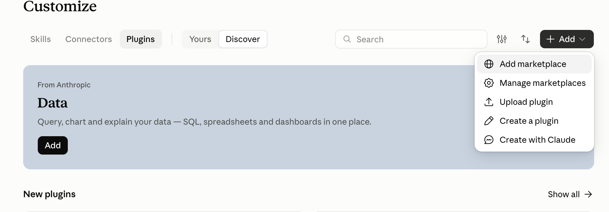

# Claude marketplace installation

For Claude web/desktop users with the Customize interface, prefer the graphical marketplace flow. Present the screenshots and steps directly rather than starting with terminal commands, ZIP uploads or manual skill copying. For a terminal-only Claude Code user, use the separate CLI instructions in the repository's `docs/plugin-installation.md`; do not assume these UI menus exist there.

1. Open **Customize → Plugins → Add → Add marketplace**. The screenshot shows the Discover tab.
2. In **URL**, enter `AllenArtefacter/agentic-artefact-skills` or `https://github.com/AllenArtefacter/agentic-artefact-skills`.
3. Recommend keeping **Sync automatically** enabled to receive repository updates; respect a user's preference for manual updates.
4. Click **Sync**. Wait for synchronization and any security scan to finish. If a warning appears, inspect its actual message; do not call the setup complete on a blocked scan.
5. Find **Agentic Artefact Project Collaboration** in the added marketplace and click **Add** to install it. Syncing a marketplace alone is not plugin installation. Verify it appears under Yours.
6. Follow [welcome.md](welcome.md) to explain meeting notes, personal tasks, project status and initialization. Then check the current host's Google tools via [dependencies.md](dependencies.md), using the user's own authorized account. Marketplace sync does not grant Google permissions.

When guiding the user, render both bundled screenshots with the host's image mechanism, resolving absolute local paths where required. If that fails, provide these public image links together with the steps:

- https://raw.githubusercontent.com/AllenArtefacter/agentic-artefact-skills/main/skills/agentic-artefact-project-collaboration/assets/onboarding/claude-add-marketplace-menu.png
- https://raw.githubusercontent.com/AllenArtefacter/agentic-artefact-skills/main/skills/agentic-artefact-project-collaboration/assets/onboarding/claude-add-marketplace-sync.png

For manual updates, open **Customize → Plugins → Add → Manage marketplaces**, locate the Artefact marketplace and use its available sync/check-for-updates action. Verify the sync result and plugin content version; the previously observed header version could lag behind the Contents version. Do not promise instant updates or infer success solely from an enabled automatic-sync toggle. Start a new conversation if the running session has not picked up the updated skill.

Avoid duplicate standalone and plugin installations. Preserve personal modifications and obtain authorization before migrating an existing standalone copy. Claude Code CLI update commands and automatic-update controls are documented separately; do not confuse them with Claude web/desktop Sync automatically.
