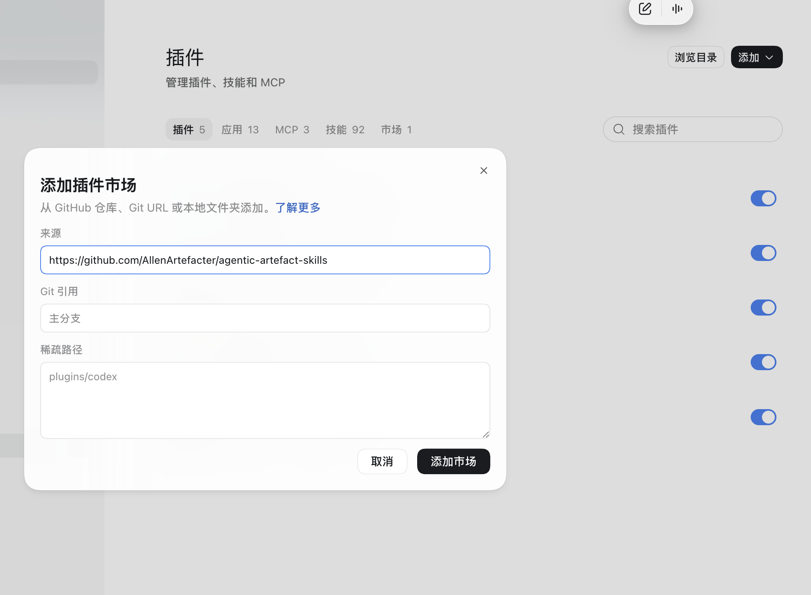

# Codex marketplace installation

For Codex desktop users, recommend the graphical installation flow first. Show the screenshot and steps together; do not lead with terminal commands or a manual skill copy unless the user prefers them or the UI is unavailable.

1. Open **Codex → Settings → Plugins → Add → Add marketplace**（设置 → 插件 → 添加 → 添加市场）.
2. In **Source / 来源**, paste `https://github.com/AllenArtefacter/agentic-artefact-skills`.
3. Leave **Git ref / Git 引用** at the default branch (or explicitly use `main`). Leave **Sparse paths / 稀疏路径** empty. The `plugins/codex` text shown in the screenshot is a UI example/placeholder, not this repository's path; do not enter it.
4. Click **Add marketplace / 添加市场**. Open **Agentic Artefact Skills**, locate **Agentic Artefact Project Collaboration**, then install/add and enable that plugin using the available UI controls. Adding a marketplace alone does not install the plugin.
5. Start a new conversation if the current one has not loaded the skill. Introduce meeting summaries, my tasks, project status and initialization using [welcome.md](welcome.md).

When presenting this guide in chat, render the bundled screenshot using the host's supported image mechanism and a resolved absolute local path where required. If local images cannot be displayed, use this public image URL as an embed or clickable fallback:
https://raw.githubusercontent.com/AllenArtefacter/agentic-artefact-skills/main/skills/agentic-artefact-project-collaboration/assets/onboarding/codex-add-marketplace.png

Plugin installation and Google authorization are separate. After installing, check actual Google tool availability and follow [dependencies.md](dependencies.md). Use the colleague's own authorized Google account. Do not ask for the maintainer's credentials.

For updates, open **Plugins → Marketplaces**, find **Agentic Artefact Skills**, and use **Upgrade / 升级**. Then check the installed plugin's version and use its update control if offered; a refreshed catalog alone is not proof the installed plugin changed. CLI fallback and standalone migration instructions remain in the repository's `docs/plugin-installation.md` and `INSTALL.md`. Avoid simultaneously enabling standalone and plugin copies of the same skill.
